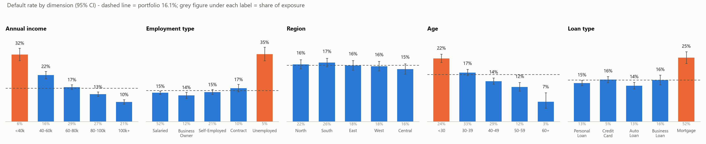
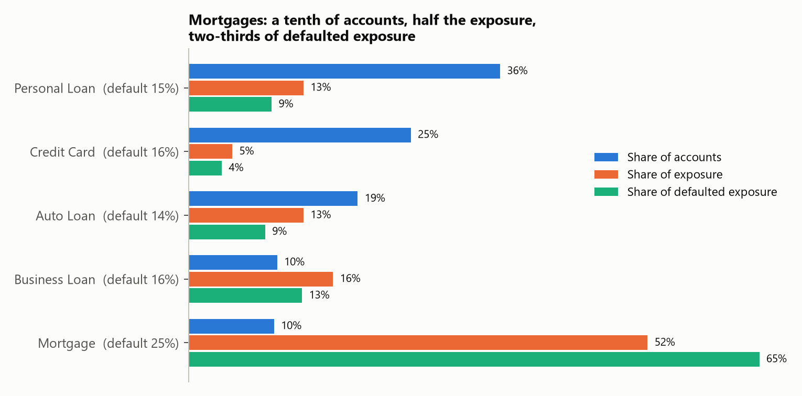
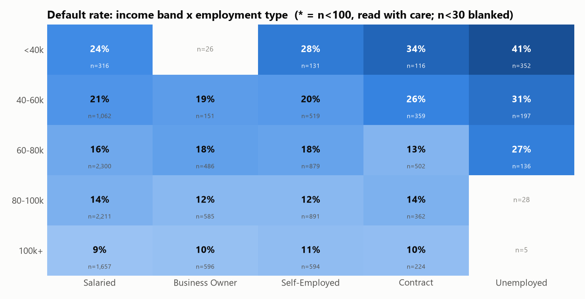
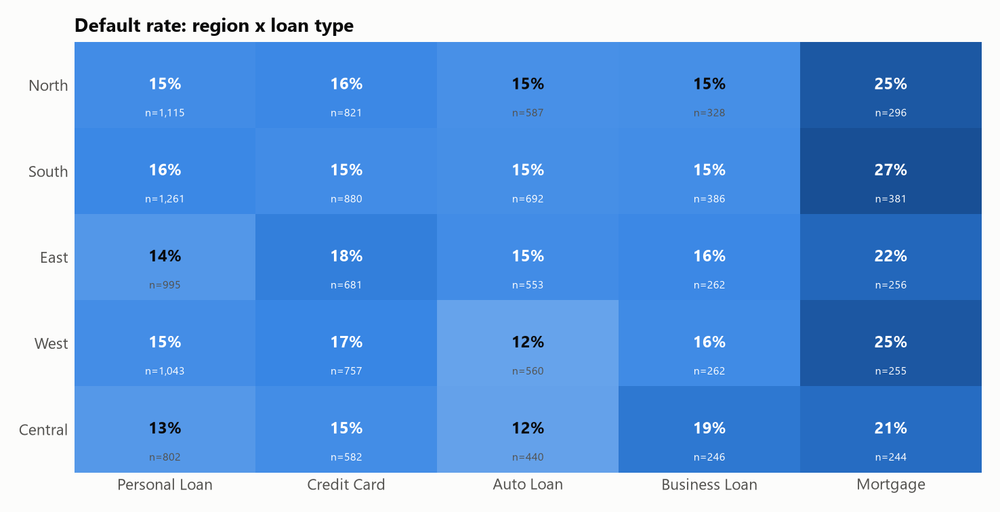
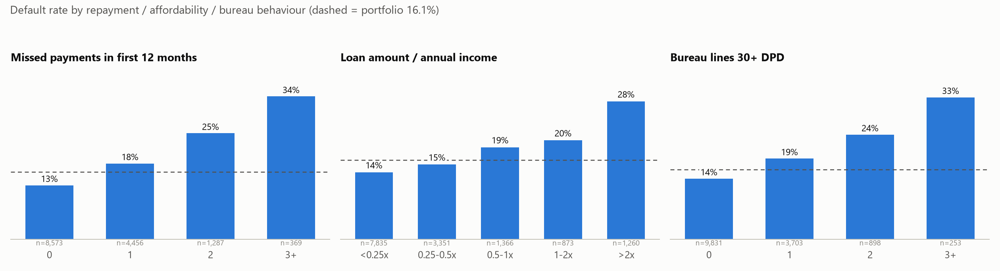
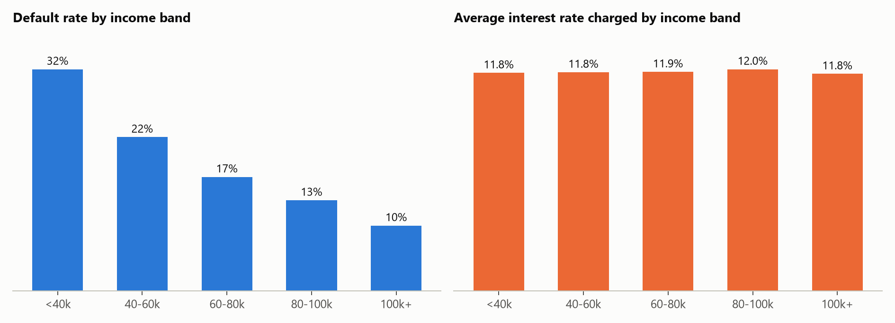

# Portfolio Analytics - Insights

_Auto-generated by `src/analytics.py` (numbers are computed, not typed). Tables: `outputs/analytics/`; charts: `outputs/analytics/charts/`._

**Portfolio:** 14,685 loan accounts, 10,000 customers, **$601M** original exposure.
Default rate **16.1%** by count, **21.1%** exposure-weighted (large loans default more).
"Exposure" = original `loan_amount`; "lift" = segment default rate / portfolio rate. Rates carry 95% Wilson intervals in the tables.

## Profiling snapshot (default rate range per dimension)
| Dimension | Lowest -> Highest | Reads as |
|---|---|---|
| Income band | 100k+ 9.5% -> <40k 32.3% | Strong, monotonic gradient |
| Employment type | Business Owner 13.6% -> Unemployed 35.0% | One outlier segment (Unemployed) |
| Age band | 60+ 6.8% -> <30 21.6% | Younger = riskier |
| Loan type | Auto Loan 13.9% -> Mortgage 24.7% | Mortgage is the outlier |
| Region | Central 15.0% -> South 16.9% | **Flat** - region barely moves default risk |

Also profiled (flat, see `portfolio_profile.csv`): city tier, housing type, education, disbursal channel, origination year, gender, marital status.

## Insight 1 - Mortgages are the concentration risk
- Mortgages are **9.8% of accounts but 52.3% of exposure** and **65% of defaulted exposure**.
- Their default rate is **24.7%** (lift 1.53x) vs 15.2% for everything else.
- **So what:** the book's loss is driven by ~1,400 accounts. Risk limits, monitoring and any model effort should be segmented by product first; a flat portfolio-wide cut-off would under-protect the mortgage book. Being secured does not lower default frequency (secured Mortgage/Auto accounts hold 65% of exposure and 74% of defaulted exposure), so loss-given-default after collateral recovery is the next question - it needs recovery data we do not have.

## Insight 2 - Income is the strongest demographic driver; unemployment adds risk on top (cross-cut: income x employment)
- Default falls steadily with income: **32.3%** (<40k) -> 22.4% -> 16.6% -> 13.2% -> **9.5%** (100k+), a 3.4x spread.
- Customers under 60k income are **22% of accounts and 22% of exposure but 34% of defaulted exposure.**
- Unemployed customers (4.9% of accounts) default at **35.0%** (2.2x). Most of that is low income (their median income is $40,450), **but it is not only income**: within the 40-60k band unemployed customers default at 31% vs 21% for salaried, and within <40k at 41% vs 24%.
- Age adds a smaller effect: under-30s default at 21.6% vs 13.8% for 40-49, and the gap holds inside each income band (17.4% vs 12.4% at 80-100k).
- **So what:** underwriting needs an income-and-employment affordability floor; the <60k segment is where tightening or pricing change moves the most defaulted exposure. Employment status should be verified, not assumed from stated income. Caveat: the 100k+ x Unemployed cell has only 5 accounts and is not read as a finding.

## Insight 3 - Region is a concentration driver, not a risk driver (cross-cut: region x loan type)
- Region default rates sit in a narrow 15.0%-16.9% band. **South** is the biggest region (26% of exposure, 28% of defaulted exposure) because it is simply the largest, not because it is riskier.
- Product matters inside every region: mortgages default at 21%-27% everywhere vs 12%-15% for auto.
- The single biggest pocket is **South x Mortgage: $84M = 14% of the whole book at a 27.3% default rate** (n=381). Central x Mortgage looks lower (21.3%, n=244), but the 95% intervals (23%-32% vs 17%-27%) overlap, so we do not claim South is riskier - only larger.
- **So what:** set exposure limits by region x product, not region alone; don't spend effort on region-specific credit policy because the data doesn't support it. Watch the South mortgage book as a single-point concentration.

## Insight 4 - Early repayment behaviour and affordability separate good from bad accounts
- Missed payments in the **first 12 months**: 12.9% default with none -> 18.1% (1) -> 25.3% (2) -> **34.1%** (3+). Accounts with 2+ missed payments are 11% of the book and 25% of defaulted exposure.
- Affordability: loan > 2x annual income defaults at **28.1%** vs 13.6% below 0.25x; EMI > 30% of income defaults at 25.7% vs 12.8% below 10%.
- Bureau: customers with three or more 30+ DPD external lines default at 32.8% vs 14.0% with none; any written-off external line lifts risk from 15.0% to 18.7%.
- **So what:** the strongest signal is behavioural, not demographic. That justifies engineering bureau and repayment aggregates for the model, and an early-warning trigger after the 2nd missed EMI. These are the features the model in step 3 should lean on.

## Insight 5 - Pricing does not follow risk
- Default rate climbs 3.4x from the 100k+ to the <40k income band, yet the **average interest rate is flat: 11.75%-12.00%** across the same bands.
- Inside each loan type, the highest-rate quartile defaults at 17.4% vs 14.7% in the lowest - only a 2.7pp slope. Rate is set by product, not by borrower risk.
- **So what:** low-income borrowers are not being compensated for the extra risk (<40k defaults at 32%). A risk score from this project could drive risk-based pricing or approval limits. Caveat: we only see stated rates, not fees, and we do not know the bank's pricing policy.

## Caveats
- Vintage (origination year) shows no trend (14.9%-17.7%); with only months 1-12 of behaviour and no calendar dates, time trends cannot be built (assumption A3).
- Associations, not causes. Segments are correlated (income, employment, age, loan size), so univariate lifts overlap; the model in step 3 separates them.
- Collections data is excluded from insights on drivers: dates are unreliable and events follow delinquency (assumption A11).
