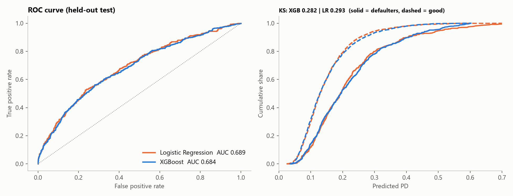
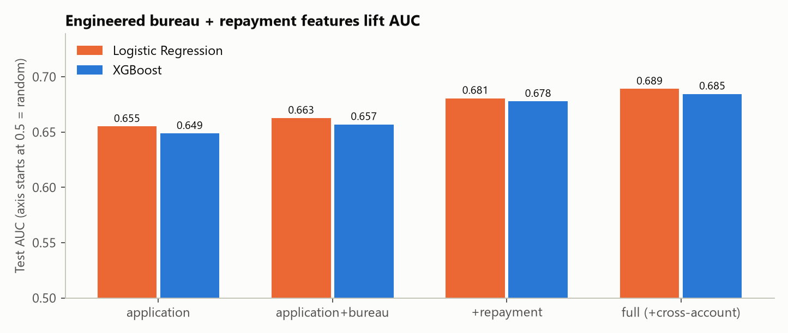
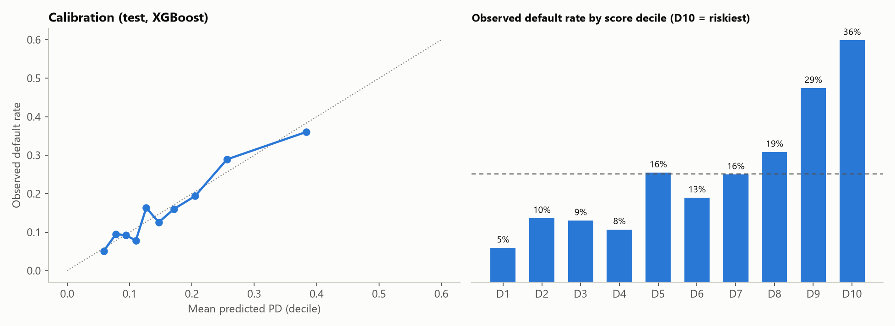
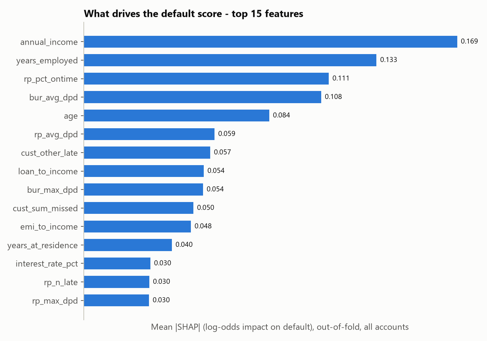
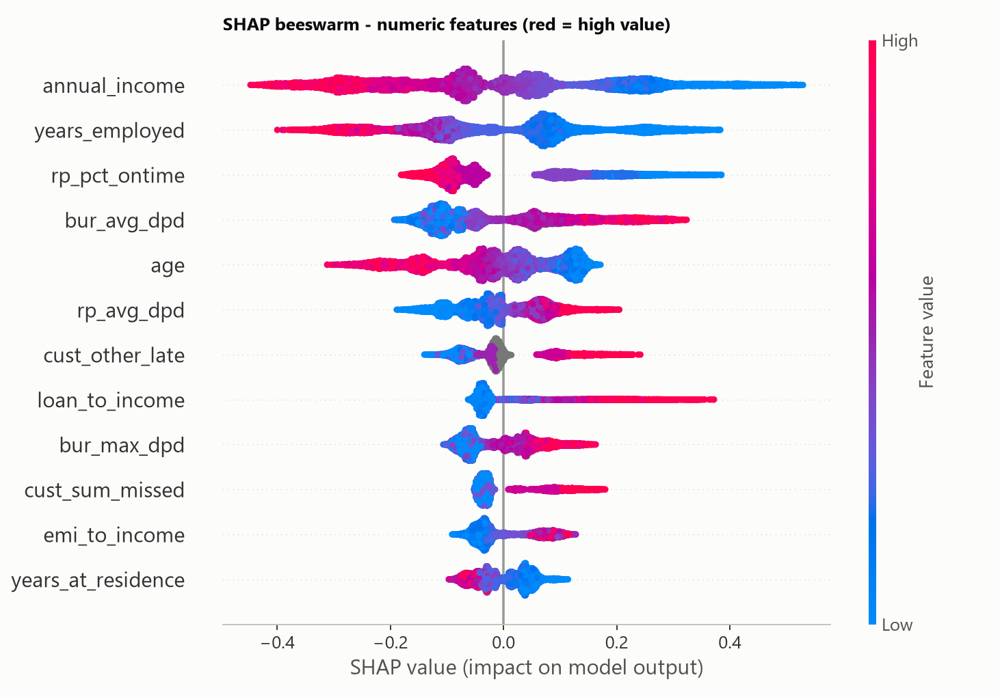

# Model Card - Default Prediction (account level)

_Auto-generated by `src/model.py`._

## Setup
- **Target:** `target_default` (1 = defaulted), 16.1% base rate. **Grain:** one row per loan account (14,685).
- **Split:** stratified, **grouped by customer** (customers have up to 3 accounts; no customer appears in both sets). Train 11,747 / test 2,938.
- **Tuning:** random search with customer-grouped 5-fold CV on train only (40 XGBoost configs, 7 logistic C values). Test set touched once.
- **Features (66):** application/loan fields + ratios, bureau aggregates (19), repayment aggregates over months 1-12 (14), cross-account behaviour of the same customer's other loans (6).
- **Deliberately excluded:**

| Excluded | Why |
|---|---|
| gender, marital_status | Protected attributes - not used in the score; monitored in the fairness check instead |
| coll_* (collections) | Post-delinquency actions: leak the target (and dates are unreliable) |
| customer_since, origination_date, orig_year/quarter | Dates inconsistent (A12) / no calendar information in repayment |
| cust_total_exposure, loan_amount, age_band, income_band | Raw or binned copies of included features / portfolio-level context |
| account_id, customer_id | Identifiers |

## Performance (held-out test)
| Model | AUC (95% CI) | Gini | KS | Brier | Train AUC | CV AUC (train) |
|---|---|---|---|---|---|---|
| Logistic regression (baseline) | 0.689 (0.662-0.718) | 0.378 | 0.293 | 0.1247 | 0.696 | 0.680 |
| XGBoost | 0.684 (0.656-0.712) | 0.367 | 0.282 | 0.1255 | 0.719 | 0.679 |

Out-of-fold over all 14,685 accounts (5-fold, customer-grouped), XGBoost: AUC 0.682, KS 0.282, Gini 0.364. These OOF scores are what the dashboard shows - no account is scored by a model that saw it in training.

**Model choice.** XGBoost and logistic regression are statistically tied on test (AUC difference 0.005, 95% intervals overlap almost entirely), and the tuner picked very shallow trees (depth 2) - the signal is largely additive, so tree interactions add little. We ship **XGBoost as the scoring model** (native handling of missing bureau data, exact SHAP drivers for the account view) and keep **logistic regression as the explainable benchmark/challenger**; a bank that prefers a plain scorecard for regulatory simplicity loses no accuracy by choosing it.

Best XGBoost params: `{"subsample": 0.7, "reg_lambda": 25, "n_estimators": 500, "min_child_weight": 10, "max_depth": 2, "learning_rate": 0.02, "gamma": 0.5, "colsample_bytree": 0.4}`

### Do the engineered features matter? (ablation, test AUC)
| feature_set           |   n_features |   xgb_auc |   xgb_ks |   lr_auc |   lr_ks |
|:----------------------|-------------:|----------:|---------:|---------:|--------:|
| application           |           27 |    0.6488 |   0.2185 |   0.6552 |  0.2275 |
| application+bureau    |           46 |    0.6569 |   0.2295 |   0.6627 |  0.2489 |
| +repayment            |           60 |    0.6779 |   0.2598 |   0.6806 |  0.2739 |
| full (+cross-account) |           66 |    0.6845 |   0.2788 |   0.6891 |  0.2928 |

> **Default definition and leakage (assumption A5 - inferred, not documented):** the data shows the flag is not derived from the 12 repayment months: max DPD is 89 (no 90+ rule possible); 8% of accounts with zero late/missed payments are flagged; and defaulters' late rate is higher from month 1 but flat to month 12 (no pre-default slide). We therefore treat the flag as an outcome *after* month 12 and the repayment features as legitimate early-warning inputs. Consequence for use: **two scoring points** - at *application* use the `application+bureau` model (AUC ~0.66, the leakage-free floor); at *12 months on book* use the full model (AUC ~0.68). If the real flag turned out to be built from these months, the repayment lift above would be overstated and the floor is the number to trust.

## Calibration and score deciles (test, XGBoost)
|   bin |   n |   mean_pred |   actual |   defaults |   cum_capture |   lift |
|------:|----:|------------:|---------:|-----------:|--------------:|-------:|
|     0 | 294 |       0.059 |    0.051 |         15 |         1     |  0.317 |
|     1 | 294 |       0.078 |    0.095 |         28 |         0.968 |  0.592 |
|     2 | 294 |       0.094 |    0.092 |         27 |         0.909 |  0.57  |
|     3 | 293 |       0.11  |    0.078 |         23 |         0.852 |  0.488 |
|     4 | 294 |       0.127 |    0.163 |         48 |         0.803 |  1.014 |
|     5 | 294 |       0.147 |    0.126 |         37 |         0.702 |  0.782 |
|     6 | 293 |       0.171 |    0.16  |         47 |         0.624 |  0.996 |
|     7 | 294 |       0.205 |    0.194 |         57 |         0.524 |  1.204 |
|     8 | 294 |       0.256 |    0.289 |         85 |         0.404 |  1.796 |
|     9 | 294 |       0.384 |    0.361 |        106 |         0.224 |  2.239 |

### Risk bands used in the dashboard (out-of-fold PD)
| risk_band   |   accounts |   mean_pd |   actual_default |   share_accounts |
|:------------|-----------:|----------:|-----------------:|-----------------:|
| Low         |       4337 |     0.078 |            0.08  |            0.295 |
| Medium      |       6664 |     0.142 |            0.139 |            0.454 |
| High        |       2895 |     0.257 |            0.263 |            0.197 |
| Very High   |        789 |     0.426 |            0.417 |            0.054 |

## Feature importance and SHAP
Mean |SHAP| aggregated back to the original feature (one-hot dummies summed), out-of-fold on all accounts. Top 10:

| feature         |   mean_abs_shap |   xgb_gain |   shap_rank |
|:----------------|----------------:|-----------:|------------:|
| annual_income   |          0.1692 |    27.1517 |           1 |
| years_employed  |          0.1326 |    17.5352 |           2 |
| rp_pct_ontime   |          0.111  |    39.5211 |           3 |
| bur_avg_dpd     |          0.1075 |    18.3433 |           4 |
| age             |          0.084  |    12.3742 |           5 |
| rp_avg_dpd      |          0.0592 |    23.3125 |           6 |
| cust_other_late |          0.0573 |    10.9663 |           7 |
| loan_to_income  |          0.0543 |    17.9597 |           8 |
| bur_max_dpd     |          0.054  |    14.7636 |           9 |
| cust_sum_missed |          0.0496 |    40.3477 |          10 |

Logistic regression standardised coefficients are in `outputs/model/lr_coefficients.csv` (the baseline's own explanation: sign and size per feature).

## Fairness / compliance check (out-of-fold, "decline the riskiest 20%" policy)
Gender and marital status are **not** model inputs. We still test whether the score disadvantages groups (e.g. through proxies). `approval_impact_ratio` = group approval rate / best group's approval rate; below 0.80 is the common "four-fifths" flag for review.

| dimension   | segment   |   accounts |   mean_pred_pd |   actual_default |   decline_rate |   auc |   approval_impact_ratio |
|:------------|:----------|-----------:|---------------:|-----------------:|---------------:|------:|------------------------:|
| gender      | Female    |       6296 |          0.162 |            0.163 |          0.208 | 0.681 |                   0.984 |
| gender      | Male      |       8389 |          0.16  |            0.16  |          0.194 | 0.683 |                   1     |
| age_band    | 30-39     |       4959 |          0.17  |            0.168 |          0.22  | 0.697 |                   0.795 |
| age_band    | 40-49     |       4279 |          0.139 |            0.138 |          0.125 | 0.639 |                   0.892 |
| age_band    | 50-59     |       1829 |          0.119 |            0.118 |          0.084 | 0.665 |                   0.934 |
| age_band    | 60+       |        368 |          0.099 |            0.068 |          0.019 | 0.551 |                   1     |
| age_band    | <30       |       3250 |          0.207 |            0.216 |          0.353 | 0.661 |                   0.659 |

Reading: differences by age band reflect real default-rate differences (young borrowers default more) - this is a policy/legal review item, not proof of a defect. Use of age in credit decisions is restricted in many jurisdictions; a bank would need compliance sign-off or to drop it.

## Monitoring plan (post-deployment)
**What to track.** *Score drift:* weekly PSI of the PD distribution against the training baseline (bins fixed on the training scores). Thresholds: < 0.10 stable, 0.10-0.25 investigate, > 0.25 trigger a model review. *Feature drift:* monthly CSI on every model input, with extra attention to the top SHAP drivers (annual_income, years_employed, rp_pct_ontime, bur_avg_dpd, age) and to the share of customers with no bureau file. *Performance:* because defaults mature slowly, track vintage-based AUC/KS/Gini and decile-wise observed vs predicted default rate (calibration) on a rolling cohort as outcomes mature, with alerts if AUC drops by more than 0.03 or any decile's observed rate is outside its 95% interval. *Fairness:* repeat the group impact-ratio table every quarter. *Data quality:* null rates, out-of-range values and join coverage per feed. **Cadence.** Scheduled retrain every 6 months, or earlier on any trigger (PSI > 0.25, AUC drop > 0.03, a policy or macro shock); recalibrate quarterly if calibration slips while ranking holds. New models run in champion/challenger shadow mode before promotion, and every version is archived with its data snapshot, parameters and validation report (model-risk-management evidence). **Baseline check today:** score PSI train vs test = 0.003 (stable); feature CSI (train vs test, should be ~0):

| feature         |    csi |
|:----------------|-------:|
| bur_utilization | 0.0097 |
| employment_type | 0.0091 |
| age             | 0.0043 |
| annual_income   | 0.0041 |
| loan_to_income  | 0.0033 |
| rp_max_dpd      | 0.0024 |
| loan_type       | 0.002  |
| rp_n_missed     | 0.0018 |
| bur_n_dpd30     | 0      |

## Known limitations
- Default definition and observation window are not documented in the data (A1, A5); results are only as valid as the label.
- Synthetic and noisy: discrimination is moderate (AUC ~0.68) and did not improve with month-level repayment, bureau-mix, ratio or deeper-tree experiments (all within +/-0.005 CV AUC) - the ceiling is the data, not the feature set. Real portfolios may behave differently and drift faster.
- Bureau is a snapshot, not point-in-time at application (A6); collections excluded (A2, A11).
- Calibration is for this portfolio's ~16% base rate; a different mix needs recalibration.
